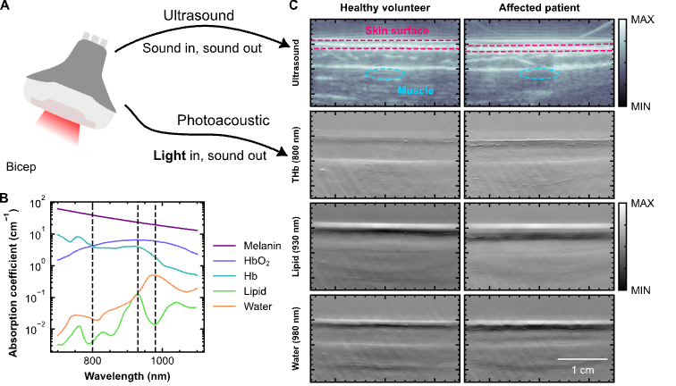

# Code for: "Photoacoustic imaging in mitochondrial disease"

### [Paper](https://www.medrxiv.org/content/10.64898/2026.03.10.26347962v1) | [Dataset](https://zenodo.org/records/22879337)

**Authors:** [Thomas R. Else](https://github.com/tomelse), Lorna Wright, Katherine Schon, May Yung Tiet, Elizabeth Ashby, Charlotte Addy, Heather Biggs, Emma Harrison, Jelle van den Ameele, Patrick F. Chinnery, Sarah E. Bohndiek, Rita Horvath. *University of Cambridge*

Contact details:  Sarah E. Bohndiek, seb53@cam.ac.uk; Rita Horvath, rh732@medschl.cam.ac.uk.


*Figure 1 from the paper, showing the process of photoacoustic data acquisition and the optical absorption spectra of key chromophores.*

This repository contains the code used for the paper "Photoacoustic imaging in mitochondrial disease". Figures from the paper can be reproduced using this code. The entire imaging dataset is available on Zenodo.

Note also, some files are available in the PAISKINTONE dataset, which is also available [on Zenodo](https://zenodo.org/records/20068219).


## Setting up the Python environment

This code relies extensively on the Python package PATATO [https://patato.rtfd.io/](https://patato.rtfd.io/). To setup a Python environment, I would recommend using something like Anaconda or [https://docs.astral.sh/uv/](uv). The deposited version of the code was tested on Mac with Python 3.13.12, but it should work on earlier versions of Python and on Mac and Linux.

```bash
git clone https://github.com/tomelse/MITOX.git
cd mitox
uv init . # (Or conda equivalent)
```
Details of the Python environment used can be found in `pyproject.toml` and `uv.lock`.

## Code description

Some shared functions can be found in `src/mitox` and can be used via `import mitox`.

Notebooks used to perform the data analysis can be found in the `notebooks` directroy. Note that full patient metadata is not provided in this repository to ensure that anonymity is preserved. However, summarised patient details are provided instead. Analysis code, therefore will not run perfectly without modification but is still provided for inspection.